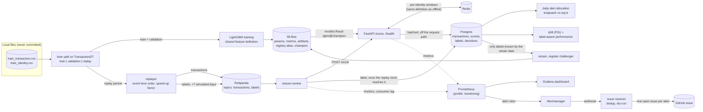

# Real-time fraud detection (simulated by replay)

An end-to-end fraud scoring system on the
[IEEE-CIS Fraud Detection](https://www.kaggle.com/c/ieee-fraud-detection) data, from event stream to
monitoring: Redpanda (Kafka), Redis online features, LightGBM + MLflow registry, FastAPI serving,
Postgres, delayed labels, review-capacity optimisation, **Prometheus/Grafana monitoring with
automatic GitHub issue filing**, load tests and CI.

## At a glance

| | |
|---|---|
| **Model** | PR-AUC 0.49 / ROC-AUC 0.90 on a time-split hold-out the model never saw; training is bit-for-bit reproducible |
| **Streaming** | 105,693 transactions through Kafka -> worker -> API -> Postgres in 154 s (about 685 txn/s); online features equal the offline ones for 100% of cells |
| **Serving** | p99 1.2 ms in the handler under replay; 1,300 req/s on one worker (Locust, one laptop) |
| **Decisions** | Knapsack allocation of a fixed review budget stops 36% more fraud money than top-k by score |
| **Monitoring** | Rolling PSI, latency, lag and error metrics, Grafana dashboard as code, alert rules unit-tested with promtool |
| **Alert -> issue** | Injected drift produced a deduplicated GitHub issue (dry-run) 57 to 83 s later; small drifts were *not* detected (measured, see below) |
| **Governance** | [Model card](docs/MODEL_CARD.md), [data card](docs/DATA_CARD.md), segment error analysis |
| **Engineering** | Typed (mypy strict), linted, tested on synthetic data in CI, Docker Compose stack, `make demo` end to end |

> **Real time is simulated.** There is no live payment traffic. The last ~37 days of the dataset
> (the *replay period*) are published to Kafka in `TransactionDT` order, paced by a configurable
> speed-up factor (the numbers below use `speedup=0`, i.e. as fast as the consumer can go). Labels
> are published later on the same simulated clock, `LABEL_DELAY_DAYS` (7) after their transaction.
> "Latency" and "throughput" are real measurements of the service on one laptop; "days" are
> simulated days.

The Kaggle data is **not** in this repository and must not be redistributed (competition rules).
`data/`, `*.csv`, `*.parquet` are git-ignored; the data directory is read from `IEEE_DATA_DIR`.
CI uses small synthetic fixtures only.

## Architecture



### Design decisions that matter

* **One feature definition, two execution paths.** `features/definitions.py` holds the row-level
  features (a pure function used by training *and* the API). The per-identity windowed features
  (`uid_cnt_1h/24h/7d`, `uid_sum_24h`, `uid_mean_7d`, `uid_amt_ratio_7d`, `uid_secs_since_last`;
  strictly from earlier transactions) have a vectorised offline implementation and a Redis online
  implementation. `tests/test_parity.py` replays a synthetic stream through both and requires
  equality, and `make parity` checks the features the live API actually served against the offline
  table for every replayed transaction.
* **Pseudo-identity** = `card1..card6 + addr1 + P_emaildomain` (the dataset has no customer id).
* **Time-based split with a label-delay purge.** Train = days < 103 (110 − 7), validation =
  days 110 to < 139 (used for early stopping only), replay = days >= 146. The 7-day gaps exist so
  no training label is one that would not yet have been known when training would have run.
* **Delayed labels are enforced, not just stored.** The worker releases a label only once the
  simulated clock of its partition (latest scored event time) has reached `available_dt`; the
  monitoring and retraining jobs select `available_dt <= as_of`. `make parity` also checks, from
  Postgres, that `available_dt = TransactionDT + delay` for all 105,693 labels and that none was
  stored before its transaction had been scored (0 violations in the final run;
  [`label_gate.json`](docs/results/label_gate.json)).
* **Alert allocation** is a 0/1 knapsack: maximise Σ p·amount subject to a daily capacity of review
  units, where a high-amount case (>= $500) costs 2 units (needs a senior analyst) and others cost 1.
  It is compared with the usual "top-k by score" and with "greedy by expected loss", plus an oracle
  using the true outcome as an upper bound.
* **Redis state is idempotent per transaction id**, so an at-least-once redelivery from Kafka is not
  counted twice and does not see itself in its own features.
* **Model loading:** the API resolves `MODEL_NAME` + `MODEL_VERSION` (an alias such as `champion`,
  or a version number) from the MLflow registry; it starts without a model, answers `/score` with
  503 and `/health` with `degraded`, and picks the model up when it is registered. `POST /admin/reload`
  re-resolves it.

## Run it

Prerequisites: Docker (OrbStack/Docker Desktop), [uv](https://docs.astral.sh/uv/), and the Kaggle
files in `~/Projects/ieee-fraud-detection/` (or set `IEEE_DATA_DIR` in `.env`).

```bash
cp .env.example .env     # local defaults, no secrets
make setup               # uv sync + pre-commit (on macOS without Homebrew's libomp it patches LightGBM)
make up                  # Postgres, Redis, Redpanda, MLflow, migrations, API, stream worker
make train               # LightGBM -> MLflow -> registry alias "champion" (API loads it by itself)
make bootstrap           # warm Redis with the history before the replay period
make replay              # publish the replay period (SPEEDUP=3600 to pace it); waits for the drain
make parity allocate monitor retrain figures
make loadtest            # Locust against /score, 60 s
```

`make demo` chains `up train bootstrap replay parity allocate monitor retrain figures`.
A cold run (images cached) takes about 4 minutes on a 12-core Apple-silicon laptop.
`make check` runs ruff, mypy and pytest. UIs: MLflow http://localhost:5001 (port 5000 is taken by
AirPlay on macOS), API docs http://localhost:8000/docs.

```bash
curl -s localhost:8000/health
curl -s -X POST 'localhost:8000/score?include_features=true' -H 'content-type: application/json' \
  -d '{"transaction_id": 1, "transaction_dt": 12700000, "transaction_amt": 59.0, "product_cd": "W",
       "card1": 13926, "card4": "visa", "card6": "debit", "addr1": 315, "p_emaildomain": "gmail.com"}'
```

The replayer can also run in a container (`docker compose --profile jobs run --rm replayer`); it
mounts the Kaggle directory read-only and never copies the data into an image.

## Results

Every number below comes from the run whose raw output is in [`docs/results/`](docs/results)
(JSON written by the pipeline; regenerated by `make demo`). Fixed seed, deterministic LightGBM:
retraining with the same seed reproduces the registered model's predictions bit for bit
([`reproducibility.json`](docs/results/reproducibility.json), `scripts/check_reproducibility.py`).

### Data and model

| split | days | rows | fraud rate |
|---|---|---|---|
| train | < 103 | 359,382 | 3.38% |
| validation | 110 to < 139 | 86,508 | 3.97% |
| replay (hold-out) | >= 146 | 105,693 | 3.42% |

LightGBM on 80 features (raw IEEE-CIS columns without the `V*` block, derived features and the 7
windowed identity features), 378 trees chosen by early stopping on validation PR-AUC.

| metric | validation (early-stopped on it) | **replay hold-out** |
|---|---|---|
| PR-AUC | 0.598 | **0.490** |
| ROC-AUC | 0.921 | 0.898 |
| recall, alerting 1% of transactions | 23.0% (precision 91%) | 24.1% (precision 82%) |
| recall, alerting 3% of transactions | 50.3% (precision 67%) | 46.1% (precision 52%) |
| fraud $ stopped, alerting 3% | 45.1% | 37.0% |

The replay column is the honest one. The model was not tuned on it, and the scores served through
the stream reproduce it exactly (PR-AUC 0.4899, ROC-AUC 0.8976 computed from Postgres), which is
what the feature-parity result below implies.

### Streaming system

* **Online/offline parity:** all 105,693 replayed transactions: 100% of numeric and categorical
  feature cells served by the API equal the offline feature table (`rtol 1e-9`).
* **Replay throughput:** 105,693 transactions + 105,693 labels through Redpanda -> worker -> API ->
  Postgres in 154 s end to end (about 685 txn/s; the worker calls `/score` sequentially, so this is
  consumer-bound, not a limit of the API). Pacing works too: with `--speedup 20000`, 500
  transactions spanning 7.2 simulated days took 31 s of wall time.
* **Server-side latency during the replay** (time inside the handler: features, Redis, model,
  excludes network and JSON parsing): p50 0.41 ms, p95 0.70 ms, p99 1.16 ms.
* **Load test** (Locust, 60 s, 1 uvicorn worker in Docker, Locust on the same laptop; payloads are
  synthetic IEEE-shaped requests; includes Redis writes and batched Postgres inserts):

| scenario | requests | failures | throughput | p50 | p95 | p99 |
|---|---|---|---|---|---|---|
| 4 concurrent users | 74,694 | 0 | 1,287 req/s | 3 ms | 4 ms | 5 ms |
| 32 concurrent users (saturated) | 78,587 | 0 | 1,354 req/s | 23 ms | 32 ms | 72 ms |

At saturation the extra latency is queueing in front of a single worker. These are client-side
figures from Locust (millisecond resolution), so they include HTTP overhead on loopback.

### More results

Allocation under a review budget, drift and delayed-label monitoring, retraining with only known
labels, and the semi-supervised study (no method beat the supervised baseline) are in
[`docs/RESULTS.md`](docs/RESULTS.md).

## Live monitoring and alerting

Opt-in with `make monitoring-up` (the plain `make demo` is unchanged): Prometheus, Alertmanager,
Grafana and a small webhook receiver. The API and worker export latency, errors, consumer lag, score
distribution, alert volume and the **rolling PSI of the score and every feature against the training
reference**. A firing alert opens **one GitHub issue per alert name** (dry-run by default; no real issue
was filed) with the values, time window, top drifting features and a dashboard link.


Measured by injecting drift into a replay at 100 transactions/s (seconds after injection, 3 runs each,
[`alerting.json`](docs/results/alerting.json)):

| injected drift | max score PSI | issue for PSI > 0.1 | issue for PSI > 0.25 |
|---|---|---|---|
| amount x2 | 0.081 | none | none |
| 50% of traffic from one email domain | 0.09 | none | none |
| amount x3 | 0.14 | **82 s** (77 to 83) | none |
| amount x5 | 0.17 | **78 s** (77 to 79) | none |
| 100% of traffic from one email domain | 0.35 | 113 s (112 to 113) | **63 s** (57 to 63) |

Small shifts go undetected, and PSI fades after its peak as per-identity features re-baseline (a
likely cause, untested). Two post-hoc changes (a 5,000-score window, a 10 s `for` on the critical rule)
are disclosed with their before/after results in [`docs/ALERTING.md`](docs/ALERTING.md), which also
covers the rules, the issue format ([example](docs/alert_issue_example.md)) and an API-outage test.

```bash
make monitoring-up
uv run fraudrt replay --rate 100 --limit 20000 --drift-after 7000 \
    --drift-field p_emaildomain --drift-value protonmail.com
make rules-check          # promtool + amtool via Docker
```

## Governance

* [Model card](docs/MODEL_CARD.md): intended use (decision support with a human in the loop, not
  automatic blocking), measured performance, segment error analysis, monitoring, retraining, and
  risks with mitigations.
* [Data card](docs/DATA_CARD.md): IEEE-CIS source and terms, splits, anonymised columns, label
  definition and known biases, privacy notes.

IEEE-CIS has no protected attributes, so fairness on protected groups cannot be assessed here; the
segment table in the model card ([`segment_errors.json`](docs/results/segment_errors.json),
`scripts/segment_errors.py`) is a proxy, not a fairness audit.

## Repository layout

```
ops/            Prometheus rules + promtool tests, Alertmanager, Grafana provisioning and dashboard
src/fraudrt/
  features/      definitions (shared), behavioral (offline + reference), online (Redis), encoding
  modeling/      train (LightGBM + MLflow), registry (load from registry), metrics
  api/           FastAPI app, pydantic schemas, scorer, batched Postgres writer
  streaming/     replayer, label-gated worker, Kafka helpers
  db/            SQLAlchemy models, repository         migrations/  Alembic
  monitoring/    PSI drift, label-aware performance, report
  observability.py  Prometheus metrics, rolling PSI     alerting/  Alertmanager webhook -> GitHub issue
  semisup.py     semi-supervised experiments    allocation.py  knapsack + baselines                  retrain.py   known-labels-only retraining
  cli.py         `fraudrt` commands                    synthetic.py CI/test data
tests/           unit, parity, API, allocation, integration (Postgres/Redis in CI)
loadtest/        Locust                                scripts/     parity, reproducibility, figures
compose.yaml  Dockerfile  Dockerfile.mlflow  Makefile  .github/workflows/ci.yml
```

CI (GitHub Actions) runs ruff, mypy, `alembic upgrade head` against a Postgres service, pytest with
Postgres and Redis services (all on synthetic fixtures, no Kaggle data), builds both Docker images,
validates the compose file (with the monitoring profile) and runs `promtool check/test rules` and
`amtool check-config` in Docker.

## Limitations

* Simulation only: no real traffic, one machine, one Kafka broker, one consumer.
* Features are deliberately light: the 339 `V*` columns, most `id_*` columns and text fields are
  not used, and hyper-parameters were not tuned. PR-AUC 0.49 on the time-split hold-out is below
  what heavily engineered Kaggle solutions reach on a random split; this repo is about the system.
* The 7-day label delay and the review-cost model (2 units above $500, a reviewed fraud is fully
  stopped) are assumptions, not properties of the dataset. The allocation numbers depend on them.
* The identity is a heuristic (`card + addr1 + email domain`); one real customer can map to several.
* Per-identity Redis state assumes events of one identity arrive in event-time order (true for the
  replay, since messages are keyed by identity). Concurrent scoring of the *same* identity could race.
* PSI is computed against the training distribution, so dataset-start effects show up as drift.
* Live monitoring: per-process metrics (one API worker; with several uvicorn workers the PSI gauges
  would need Prometheus multiprocess mode), the drift experiments are synthetic shifts on a replay
  and say nothing about real drift, and the receiver's GitHub path is tested against a mocked API only.
* The 1-worker API reaches about 1,300 req/s. A 4-worker run on the same laptop did not scale
  (16 users: 345 req/s, p50 46 ms while the handler itself took ~0.3 ms); the cause (probably the
  Docker/loopback networking with keep-alive connections) was not investigated.
* LightGBM on macOS needs libomp; `make setup` patches the wheel to use the copy bundled with
  scikit-learn when Homebrew's is absent.
* Credentials in `compose.yaml` are throw-away local defaults.
