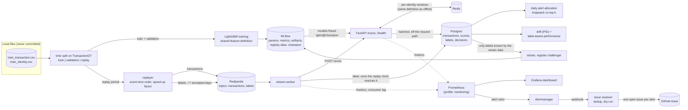
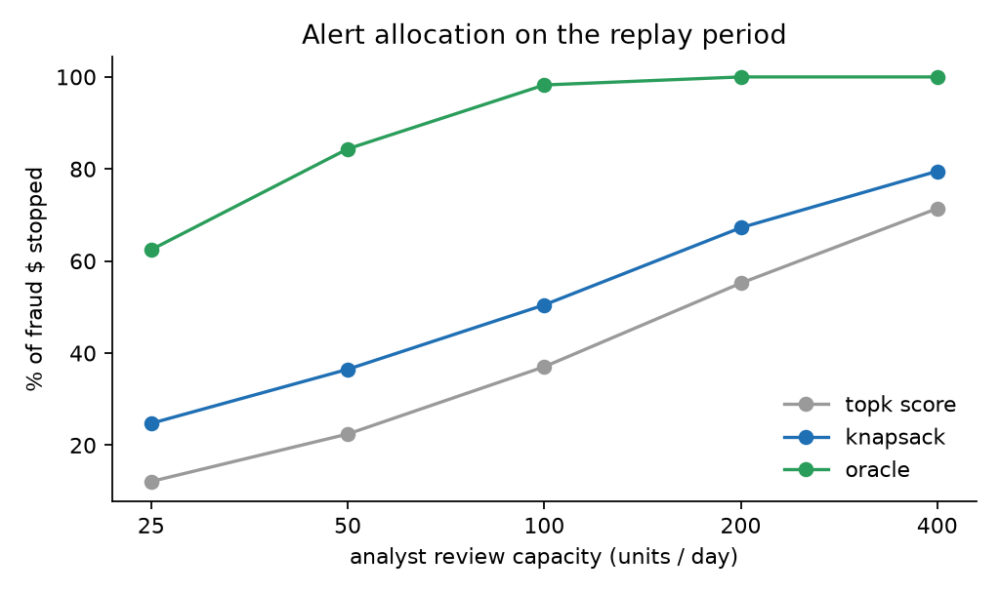
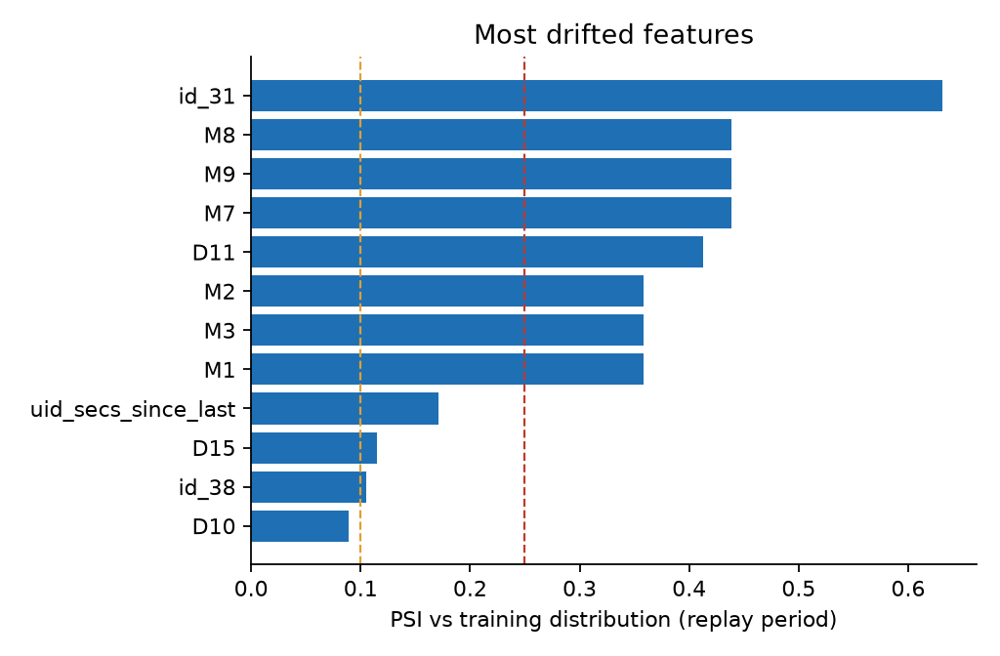
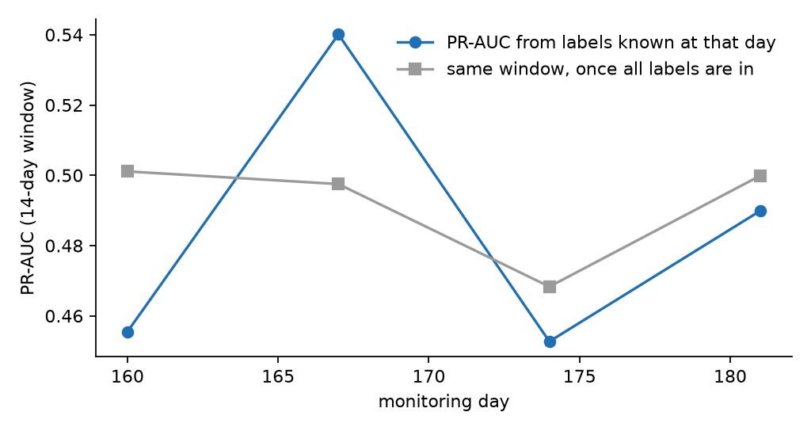
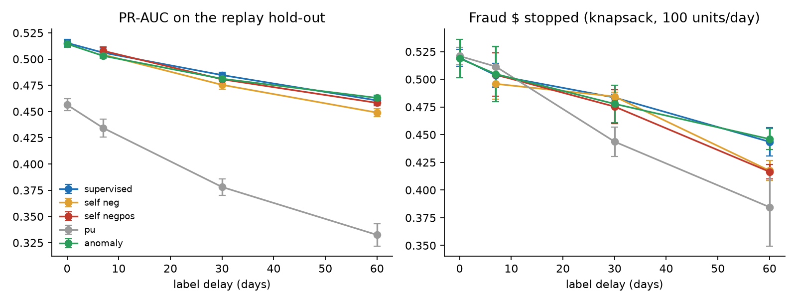

# Real-time fraud detection (simulated by replay)

An end-to-end, production-style fraud scoring system built on the
[IEEE-CIS Fraud Detection](https://www.kaggle.com/c/ieee-fraud-detection) data:
a Redpanda event stream, Redis online features, a LightGBM model served by FastAPI from an
MLflow registry, Postgres storage, delayed ground-truth labels, a daily review-capacity
allocation step, drift monitoring, load tests and CI.

> **Real time is simulated.** There is no live payment traffic. The last ~37 days of the dataset
> (the *replay period*) are published to Kafka in `TransactionDT` order, paced by a configurable
> speed-up factor (the numbers below use `speedup=0`, i.e. as fast as the consumer can go). Labels
> are published later on the same simulated clock, `LABEL_DELAY_DAYS` (7) after their transaction.
> "Latency" and "throughput" are real measurements of the service on one laptop; "days" are
> simulated days.

The Kaggle data is **not** in this repository and must not be redistributed (competition rules).
`data/`, `*.csv`, `*.parquet` are git-ignored; the data directory is read from `IEEE_DATA_DIR`.
CI uses small synthetic fixtures only.

## Architecture



### Design decisions that matter

* **One feature definition, two execution paths.** `features/definitions.py` holds the row-level
  features (a pure function used by training *and* the API). The per-identity windowed features
  (`uid_cnt_1h/24h/7d`, `uid_sum_24h`, `uid_mean_7d`, `uid_amt_ratio_7d`, `uid_secs_since_last`;
  strictly from earlier transactions) have a vectorised offline implementation and a Redis online
  implementation. `tests/test_parity.py` replays a synthetic stream through both and requires
  equality, and `make parity` checks the features the live API actually served against the offline
  table for every replayed transaction.
* **Pseudo-identity** = `card1..card6 + addr1 + P_emaildomain` (the dataset has no customer id).
* **Time-based split with a label-delay purge.** Train = days < 103 (110 − 7), validation =
  days 110 to < 139 (used for early stopping only), replay = days >= 146. The 7-day gaps exist so
  no training label is one that would not yet have been known when training would have run.
* **Delayed labels are enforced, not just stored.** The worker releases a label only once the
  simulated clock of its partition (latest scored event time) has reached `available_dt`; the
  monitoring and retraining jobs select `available_dt <= as_of`. `make parity` also checks, from
  Postgres, that `available_dt = TransactionDT + delay` for all 105,693 labels and that none was
  stored before its transaction had been scored (0 violations in the final run;
  [`label_gate.json`](docs/results/label_gate.json)).
* **Alert allocation** is a 0/1 knapsack: maximise Σ p·amount subject to a daily capacity of review
  units, where a high-amount case (>= $500) costs 2 units (needs a senior analyst) and others cost 1.
  It is compared with the usual "top-k by score" and with "greedy by expected loss", plus an oracle
  using the true outcome as an upper bound.
* **Redis state is idempotent per transaction id**, so an at-least-once redelivery from Kafka is not
  counted twice and does not see itself in its own features.
* **Model loading:** the API resolves `MODEL_NAME` + `MODEL_VERSION` (an alias such as `champion`,
  or a version number) from the MLflow registry; it starts without a model, answers `/score` with
  503 and `/health` with `degraded`, and picks the model up when it is registered. `POST /admin/reload`
  re-resolves it.

## Run it

Prerequisites: Docker (OrbStack/Docker Desktop), [uv](https://docs.astral.sh/uv/), and the Kaggle
files in `~/Projects/ieee-fraud-detection/` (or set `IEEE_DATA_DIR` in `.env`).

```bash
cp .env.example .env     # local defaults, no secrets
make setup               # uv sync + pre-commit (on macOS without Homebrew's libomp it patches LightGBM)
make up                  # Postgres, Redis, Redpanda, MLflow, migrations, API, stream worker
make train               # LightGBM -> MLflow -> registry alias "champion" (API loads it by itself)
make bootstrap           # warm Redis with the history before the replay period
make replay              # publish the replay period (SPEEDUP=3600 to pace it); waits for the drain
make parity allocate monitor retrain figures
make loadtest            # Locust against /score, 60 s
```

`make demo` chains `up train bootstrap replay parity allocate monitor retrain figures`.
A cold run (images cached) takes about 4 minutes on a 12-core Apple-silicon laptop.
`make check` runs ruff, mypy and pytest. UIs: MLflow http://localhost:5001 (port 5000 is taken by
AirPlay on macOS), API docs http://localhost:8000/docs.

```bash
curl -s localhost:8000/health
curl -s -X POST 'localhost:8000/score?include_features=true' -H 'content-type: application/json' \
  -d '{"transaction_id": 1, "transaction_dt": 12700000, "transaction_amt": 59.0, "product_cd": "W",
       "card1": 13926, "card4": "visa", "card6": "debit", "addr1": 315, "p_emaildomain": "gmail.com"}'
```

The replayer can also run in a container (`docker compose --profile jobs run --rm replayer`); it
mounts the Kaggle directory read-only and never copies the data into an image.

## Results

Every number below comes from the run whose raw output is in [`docs/results/`](docs/results)
(JSON written by the pipeline; regenerated by `make demo`). Fixed seed, deterministic LightGBM:
retraining with the same seed reproduces the registered model's predictions bit for bit
([`reproducibility.json`](docs/results/reproducibility.json), `scripts/check_reproducibility.py`).

### Data and model

| split | days | rows | fraud rate |
|---|---|---|---|
| train | < 103 | 359,382 | 3.38% |
| validation | 110 to < 139 | 86,508 | 3.97% |
| replay (hold-out) | >= 146 | 105,693 | 3.42% |

LightGBM on 80 features (raw IEEE-CIS columns without the `V*` block, derived features and the 7
windowed identity features), 378 trees chosen by early stopping on validation PR-AUC.

| metric | validation (early-stopped on it) | **replay hold-out** |
|---|---|---|
| PR-AUC | 0.598 | **0.490** |
| ROC-AUC | 0.921 | 0.898 |
| recall, alerting 1% of transactions | 23.0% (precision 91%) | 24.1% (precision 82%) |
| recall, alerting 3% of transactions | 50.3% (precision 67%) | 46.1% (precision 52%) |
| fraud $ stopped, alerting 3% | 45.1% | 37.0% |

The replay column is the honest one. The model was not tuned on it, and the scores served through
the stream reproduce it exactly (PR-AUC 0.4899, ROC-AUC 0.8976 computed from Postgres), which is
what the feature-parity result below implies.

### Streaming system

* **Online/offline parity:** all 105,693 replayed transactions: 100% of numeric and categorical
  feature cells served by the API equal the offline feature table (`rtol 1e-9`).
* **Replay throughput:** 105,693 transactions + 105,693 labels through Redpanda -> worker -> API ->
  Postgres in 154 s end to end (about 685 txn/s; the worker calls `/score` sequentially, so this is
  consumer-bound, not a limit of the API). Pacing works too: with `--speedup 20000`, 500
  transactions spanning 7.2 simulated days took 31 s of wall time.
* **Server-side latency during the replay** (time inside the handler: features, Redis, model,
  excludes network and JSON parsing): p50 0.41 ms, p95 0.70 ms, p99 1.16 ms.
* **Load test** (Locust, 60 s, 1 uvicorn worker in Docker, Locust on the same laptop; payloads are
  synthetic IEEE-shaped requests; includes Redis writes and batched Postgres inserts):

| scenario | requests | failures | throughput | p50 | p95 | p99 |
|---|---|---|---|---|---|---|
| 4 concurrent users | 74,694 | 0 | 1,287 req/s | 3 ms | 4 ms | 5 ms |
| 32 concurrent users (saturated) | 78,587 | 0 | 1,354 req/s | 23 ms | 32 ms | 72 ms |

At saturation the extra latency is queueing in front of a single worker. These are client-side
figures from Locust (millisecond resolution), so they include HTTP overhead on loopback.

### Alert allocation under a fixed review capacity

Replay period, 37 days, 3,611 frauds worth $539,698. Capacity: 100 review units per day (a case over
$500 costs 2, others 1). "Money saved" = amount of the frauds among the reviewed cases, assuming a
reviewed fraud is stopped.

| policy | reviews | frauds caught | recall | **fraud $ stopped** | share of fraud $ | expected loss saved (model) |
|---|---|---|---|---|---|---|
| top-k by score (baseline) | 3,512 | 1,686 | 46.7% | $199,873 | 37.0% | $202,636 |
| greedy by p x amount | 2,805 | 1,066 | 29.5% | $284,485 | 52.7% | $238,708 |
| **knapsack (exact DP)** | 3,097 | 1,203 | 33.3% | **$272,379** | **50.5%** | **$242,645** |
| oracle (true outcomes) | 3,122 | 3,122 | 86.5% | $530,264 | 98.3% | n/a |



The knapsack stops 36% more fraud money than top-k by score at the same capacity (50.5% vs 37.0%
of fraud $), while catching fewer fraudulent transactions (1,203 vs 1,686): it spends reviews on
large amounts. It maximises *expected* loss saved, which it does (greedy is within 2%); on
realised money greedy-by-value happens to land $12k higher at this capacity, so the two should be
read as equivalent here. The gap between "greedy" and "knapsack" only exists because costs are
non-uniform; with unit costs they coincide (tested). The capacity sweep (25 to 400 units/day) is in
[`allocation.json`](docs/results/allocation.json): knapsack beats top-k at every capacity (e.g. 24.7%
vs 12.1% of fraud $ at 25 units/day, 79.5% vs 71.4% at 400).

### Drift and label-aware monitoring

PSI of each served feature and of the score against the training distribution
([`monitoring.json`](docs/results/monitoring.json)):

* **Score PSI 0.0008** overall (weekly values 0.0006 to 0.009): the score distribution is stable.
* 8 of 80 features have PSI >= 0.25 and 3 are between 0.1 and 0.25. Largest: `id_31` (browser
  version, 0.63), `M8`/`M9`/`M7` (0.44), `D11` (0.41), `M1`-`M3` (0.36).
* `uid_secs_since_last` (0.17, stable at 0.13 to 0.21 each week) partly reflects the dataset's cold
  start: the first training days have no identity history, so "first seen" is over-represented in
  the reference. The other windowed identity features have weekly PSI < 0.05.



**Delayed labels.** With a 7-day delay, a monitoring job on day T can only score transactions up to
day T − 7. `asof_performance` evaluates, every 7 days, the last 14 days of traffic using only labels
known at that day (about half of that window, 49% to 53%) and compares with the same transactions
once all labels are in:

| monitoring day | labels known / scored | PR-AUC from known labels | PR-AUC with all labels |
|---|---|---|---|
| 153 | 0 / 20,263 | n/a | 0.456 |
| 160 | 20,263 / 41,230 | 0.456 | 0.501 |
| 167 | 20,967 / 41,769 | 0.540 | 0.498 |
| 174 | 20,802 / 41,191 | 0.453 | 0.468 |
| 181 | 20,389 / 38,168 | 0.490 | 0.500 |



The delayed estimate is noisy (about 620 to 770 frauds per window) and always about a week stale;
that is why the label-free score/feature PSI is what would alert first.

### Retraining with only the labels known at the time

`make retrain` simulates retraining on day 165 (RETRAIN_DAY): training data = history plus replayed
transactions *as served* (features exactly as the model saw them) whose label had arrived by day 165:
498,113 training rows (13,266 from the replay period) and 22,071 replay rows for early stopping. The
challenger is registered as a new model version and **not** promoted. Evaluated on the replay days
after the retraining date (days 166 to 182, 49,630 transactions, all labels):

| model | PR-AUC | ROC-AUC | recall @ 3% alerts | fraud $ stopped @ 3% alerts |
|---|---|---|---|---|
| champion v1 (trained on days < 103) | 0.491 | 0.898 | 44.3% | $107,525 (35.8%) |
| challenger v2 (day-165 retrain) | 0.549 | 0.920 | 48.9% | $127,877 (42.5%) |

A single split, no confidence intervals; the champion was about two months stale at that point.

## Semi-supervised learning under delayed labels

Question: when labels arrive late, can the unlabelled recent transactions help? At the retraining
time T (start of the replay period) and a label delay *d*, only transactions up to day T - d have a
label; the *d* most recent days are unlabelled. `fraudrt semisup` trains each method on that
state and evaluates on the same hold-out as above (days >= 146, 105,693 transactions), 5 seeds per
cell, every run tracked in MLflow (experiment `semi-supervised-delayed-labels`). Early stopping uses
the newest 21 labelled days. Offline experiment: it does not go through the stream.

* **supervised** - LightGBM on the labelled part (baseline).
* **self_neg / self_negpos** - one round of pseudo-labelling of the unlabelled window with the
  baseline, isotonic-calibrated on validation: negatives below p = 0.01; for `self_negpos` also
  positives above p = 0.7, capped at half of the expected frauds in that window (guards against
  confirmation bias).
* **pu** - Elkan-Noto PU learning: known frauds vs everything else, scores divided by the estimated
  label frequency c.
* **anomaly** - Isolation Forest on the numeric features, fitted on all rows before T without labels,
  added as a feature (`features/anomaly.py`).

PR-AUC on the hold-out, mean +/- std over 5 seeds:

| delay (labelled / unlabelled rows) | supervised | self_neg | self_negpos | pu | anomaly |
|---|---|---|---|---|---|
| 0 d (all labelled) | **0.515 +/- 0.003** | n/a | n/a | 0.456 +/- 0.006 | 0.515 +/- 0.003 |
| 7 d | 0.506 +/- 0.005 | 0.504 +/- 0.003 | **0.508 +/- 0.004** | 0.434 +/- 0.008 | 0.503 +/- 0.002 |
| 30 d | **0.485 +/- 0.003** | 0.476 +/- 0.004 | 0.481 +/- 0.005 | 0.378 +/- 0.008 | 0.481 +/- 0.005 |
| 60 d | 0.461 +/- 0.004 | 0.449 +/- 0.004 | 0.458 +/- 0.003 | 0.333 +/- 0.011 | **0.463 +/- 0.003** |



What the runs say (full table incl. ROC-AUC, recall at 3% alerts, knapsack money saved, cold-start
PR-AUC: [`semisup_summary.csv`](docs/results/semisup_summary.csv), per-run:
[`semisup_runs.csv`](docs/results/semisup_runs.csv)):

* **Delay hurts, and that is the real effect:** PR-AUC drops from 0.515 (d = 0) to 0.461 (d = 60),
  and fraud $ stopped by the knapsack from 51.9% to 44.4%.
* **None of the semi-supervised methods beats the supervised baseline outside noise.** Self-training
  is equal or slightly worse (-0.012 at d = 60 for negatives only). The pseudo-labels are decent
  (pseudo-negatives contain 0.5% to 0.6% frauds against a ~3.4% base rate; capped
  pseudo-positives are 77% to 83% precise, see
  [`semisup_diagnostics.csv`](docs/results/semisup_diagnostics.csv)) but they carry no information
  the baseline did not already have (a plausible reading, not tested separately).
* **PU learning is clearly worse** (0.33 to 0.46). Here the labelled negatives are genuine, so
  treating them as unlabelled throws information away; the estimated label frequency c falls from
  0.37 to 0.09 as the delay grows, i.e. PU's correction is driven by the unlabelled window. PU would
  be the right framing only if many "negatives" were hidden frauds, which this dataset cannot show.
* **Anomaly score:** +0.002 PR-AUC at d = 60 (about one standard deviation), 0 or slightly negative
  elsewhere; cold-start PR-AUC (first-seen identities) is also within noise (0.534 vs 0.530 at d = 60).
  Not significant, so **it is not served by `/score`**. It is implemented as a shared feature
  definition with batch/online equality tested (`test_anomaly_score_batch_equals_online_row`), so
  wiring it in later needs only a model trained with it.

Caveats: one split and one retrain time; the retraining time here (day 146) is not the stream
retrain of the previous section; a small autoencoder was not tried; thresholds (0.01 / 0.7 / cap)
were fixed in advance and not tuned.

## Governance

* [Model card](docs/MODEL_CARD.md): intended use (decision support with a human in the loop, not
  automatic blocking), measured performance, segment error analysis, monitoring, retraining, and
  risks with mitigations.
* [Data card](docs/DATA_CARD.md): IEEE-CIS source and terms, splits, anonymised columns, label
  definition and known biases, privacy notes.

IEEE-CIS has no protected attributes, so fairness on protected groups cannot be assessed here; the
segment table in the model card ([`segment_errors.json`](docs/results/segment_errors.json),
`scripts/segment_errors.py`) is a proxy, not a fairness audit.

## Repository layout

```
src/fraudrt/
  features/      definitions (shared), behavioral (offline + reference), online (Redis), encoding
  modeling/      train (LightGBM + MLflow), registry (load from registry), metrics
  api/           FastAPI app, pydantic schemas, scorer, batched Postgres writer
  streaming/     replayer, label-gated worker, Kafka helpers
  db/            SQLAlchemy models, repository         migrations/  Alembic
  monitoring/    PSI drift, label-aware performance, report
  semisup.py     semi-supervised experiments    allocation.py  knapsack + baselines                  retrain.py   known-labels-only retraining
  cli.py         `fraudrt` commands                    synthetic.py CI/test data
tests/           unit, parity, API, allocation, integration (Postgres/Redis in CI)
loadtest/        Locust                                scripts/     parity, reproducibility, figures
compose.yaml  Dockerfile  Dockerfile.mlflow  Makefile  .github/workflows/ci.yml
```

CI (GitHub Actions) runs ruff, mypy, `alembic upgrade head` against a Postgres service, pytest with
Postgres and Redis services (all on synthetic fixtures, no Kaggle data) and builds both Docker images.

## Limitations

* Simulation only: no real traffic, one machine, one Kafka broker, one consumer.
* Features are deliberately light: the 339 `V*` columns, most `id_*` columns and text fields are
  not used, and hyper-parameters were not tuned. PR-AUC 0.49 on the time-split hold-out is below
  what heavily engineered Kaggle solutions reach on a random split; this repo is about the system.
* The 7-day label delay and the review-cost model (2 units above $500, a reviewed fraud is fully
  stopped) are assumptions, not properties of the dataset. The allocation numbers depend on them.
* The identity is a heuristic (`card + addr1 + email domain`); one real customer can map to several.
* Per-identity Redis state assumes events of one identity arrive in event-time order (true for the
  replay, since messages are keyed by identity). Concurrent scoring of the *same* identity could race.
* PSI is computed against the training distribution, so dataset-start effects show up as drift.
* The 1-worker API reaches about 1,300 req/s. A 4-worker run on the same laptop did not scale
  (16 users: 345 req/s, p50 46 ms while the handler itself took ~0.3 ms); the cause (probably the
  Docker/loopback networking with keep-alive connections) was not investigated.
* LightGBM on macOS needs libomp; `make setup` patches the wheel to use the copy bundled with
  scikit-learn when Homebrew's is absent.
* Credentials in `compose.yaml` are throw-away local defaults.
