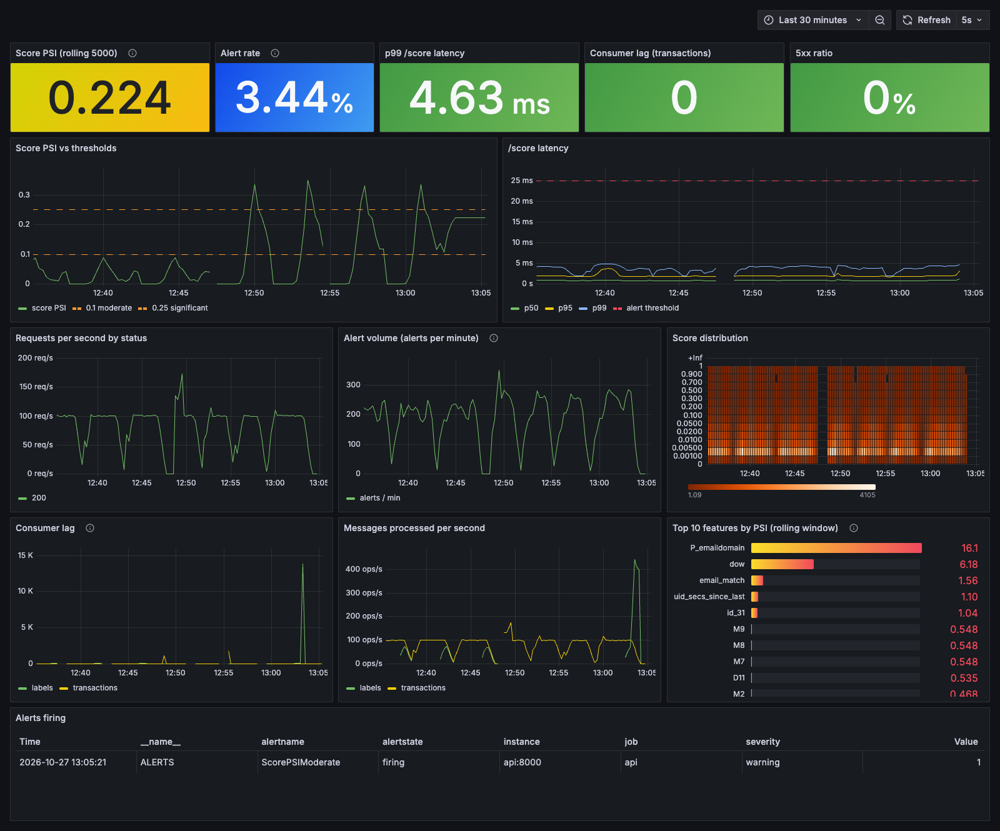

# Live monitoring and alerting

Detail for the [README](../README.md) section of the same name.


Opt-in (`make monitoring-up`; the plain `make up` / `make demo` are unchanged). It adds Prometheus,
Alertmanager, Grafana and a small webhook receiver to the compose stack.

* **Metrics** (`/metrics` on the API, port 9101 on the worker): `/score` latency histogram (p50/p95/p99
  via `histogram_quantile`), requests and errors by route/status, score histogram, alert volume (scores
  >= 0.18, about 3% of the replay scores), consumer lag per topic/partition, messages processed, and
  the **rolling PSI of the last 5,000 scores and of every feature against the training reference**
  (`fraud_score_psi`, `fraud_feature_psi{feature}`, recomputed every 5 s in a background thread).
* **Dashboard** provisioned from [`ops/grafana/dashboards/fraud-monitoring.json`](../ops/grafana/dashboards/fraud-monitoring.json)
  (http://localhost:3000, anonymous read-only, local demo only). Screenshot of the last 30 minutes of
  the experiment below (three drift episodes; the live alert table at the bottom):



* **Alert rules** ([`ops/prometheus/alerts.yml`](../ops/prometheus/alerts.yml), unit-tested with
  `promtool test rules` in CI): p99 `/score` latency > 25 ms for 1 min; 5xx ratio > 5% for 1 min;
  transactions-topic lag > 1,000 and growing for 2 min; score PSI > 0.1 (30 s) and > 0.25 (10 s);
  a scrape target down. Alertmanager groups by alert name and an alert above 0.25 inhibits the 0.1 one.
* **Automatic issue filing** (`fraudrt alert-receiver`): Alertmanager's webhook creates **one open
  GitHub issue per alert name** (dedup by the label `alert:<name>`; repeat notifications are skipped,
  a resolved alert adds a comment and leaves the issue open). The body has the alert, the value that
  fired it, the time window, a table of current readings (PSI, alert rate, p99, 5xx, lag, req/s), the
  features with the highest PSI and those whose PSI rose most, and a Grafana link with the time range.
  **Dry-run is the default**: the body is written to `work/issues/<alert>.md` and nothing is sent. Real
  issues need `ALERT_DRY_RUN=false`, `GITHUB_REPOSITORY` and a `GITHUB_TOKEN` (env only). CI and the
  tests use dry-run or a mocked HTTP transport. Example output:
  [`docs/alert_issue_example.md`](alert_issue_example.md). **No real issue has been created.**

```bash
make monitoring-up          # + make train bootstrap, then a paced replay with drift:
uv run fraudrt replay --rate 100 --limit 20000 --drift-after 7000 \
    --drift-field p_emaildomain --drift-value protonmail.com
uv run python scripts/alerting_experiment.py        # the measured experiment below (about 1 h)
make rules-check            # promtool check/test + amtool via Docker
```

## Measured: time from drift injection to alert to issue

`scripts/alerting_experiment.py` resets the stack, replays at a constant 100 transactions/s and, after
7,000 transactions, changes the traffic (`fraudrt replay --drift-*`). Timestamps are host wall-clock;
"issue written" is the dry-run receiver finishing the file (a real GitHub call would add its own
latency, not measured). Config: PSI window 5,000, scrape / evaluation / PSI refresh 5 s, `for` 30 s
(0.1 alert) and 10 s (0.25 alert), Alertmanager `group_wait` 5 s. Raw runs:
[`docs/results/alerting.json`](results/alerting.json). Seconds after injection, median
(min to max) over 3 runs (the x2 scenario: 1 run):

| injected drift | max score PSI | PSI gauge > 0.1 | issue for `ScorePSIModerate` (> 0.1) | issue for `ScorePSISignificant` (> 0.25) |
|---|---|---|---|---|
| amount x2 | 0.081 | never | none | none |
| 50% of transactions from protonmail.com | 0.09 | never | none | none |
| amount x3 | 0.14 | 48 s | **82 s** (77 to 83) | none |
| amount x5 | 0.17 | 43 s | **78 s** (77 to 79) | none |
| 100% of transactions from protonmail.com | 0.35 | 29 s | 113 s (112 to 113) | **63 s** (57 to 63) |

How to read it:

* The floor is the configuration, not the code: about 40 s for the 5,000-transaction window to hold
  enough drifted rows, plus the rule's `for` (30 s), plus 4 to 5 s of Alertmanager `group_wait`; the
  receiver itself adds under 1 s. Only the window fill depends on the traffic rate.
* Before the injection the score PSI never exceeded 0.0034 and no alert was active (16 runs). The
  window is 5,000 because 2,000 gave a false alarm on normal traffic: replaying the 37 hold-out days,
  the 2,000-window PSI exceeded 0.1 at 1.5% of positions (max 0.16) while the 5,000-window never did
  (max 0.067; [`psi_window.json`](results/psi_window.json)).
* **Small drifts are not detected** (x2 amount, half the traffic from one domain: PSI 0.08 to 0.09).
  This is the sensitivity of "score PSI > 0.1", not a bug.
* **The drift fades.** After the peak, PSI falls back (for amount x5: 0.17 at about +60 s, 0.07 to 0.09
  at +120 to +160 s) so the 0.1 alert resolved inside the run. A likely reason is that the per-identity
  features (`uid_amt_ratio_7d`, `uid_secs_since_last`) re-baseline once the Redis state holds drifted
  history; this was not tested. In the 100% case the PSI crossed 0.25 within 30 s, which reset the
  0.1 alert's `for` (its rule excludes > 0.25); it fired later (113 s) when PSI settled in the band.
* **Post-hoc changes, disclosed.** (1) The amount scenarios were chosen first; none reached 0.25, so
  the protonmail scenarios were added afterwards. (2) With `for: 30s` on the 0.25 alert the critical
  alert went pending but never fired in 3 of 3 runs (PSI stayed above 0.25 for under 30 s); I then
  set it to 10 s and re-ran. The first result is kept in the JSON as
  `email_domain_all_protonmail_critical_for30s`.
* **Failure modes** ([`alerting_outage.json`](results/alerting_outage.json), one run): stopping the
  API container 60 s into a 100 tx/s replay fired `ScrapeTargetDown` (issue at +70 s) and
  `ConsumerLagGrowing` (issue at +140 s; lag 25,668 after 260 s); resolved comments followed after the
  restart. The latency and 5xx rules are covered by `promtool` unit tests with synthetic series only;
  they were not triggered live.

